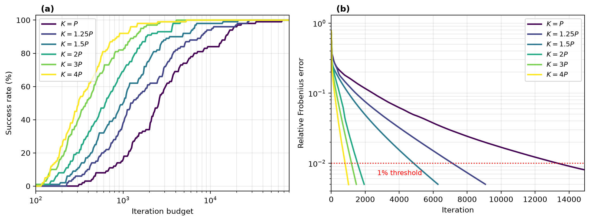

# The Optimization Landscape of Carathéodory Decomposition of Toeplitz Covariances

Daniel Busbib, [Ami Wiesel](https://www.cs.huji.ac.il/~amiw/)

School of Computer Science and Engineering, The Hebrew University of Jerusalem

**[Paper (arXiv)](https://arxiv.org/abs/2511.01605)** | **[Project page](https://wiesel-lab.github.io/toeplitz-caratheodory/)**

Official implementation of *The Optimization Landscape of Carathéodory
Decomposition of Toeplitz Covariances* (arXiv:2511.01605).

<p align="center">
  
</p>

## Abstract

Toeplitz covariance estimation is a classical problem in statistical signal
processing, yet the geometry of the Gaussian maximum-likelihood objective
remains only partially understood. Recent algorithms, including Newton-type,
majorization-minimization, and gradient-based methods, indicate that the
nonconvex problem can often be globally solved when the number of samples is
sufficiently large, but they also reveal a difficult computational landscape.
In this work, we study this phenomenon through an overparameterized
Carathéodory representation of positive definite Toeplitz covariance matrices,
which parameterizes the covariance by the frequencies and amplitudes of a set
of steering vectors. A simple example shows that, for any uniform frequency
grid, optimizing only the amplitudes can leave a strictly positive error even
in the population setting, which motivates optimizing the frequencies together
with the amplitudes. Our main result proves that this joint optimization has a
benign population landscape: every stationary point that produces a positive
definite covariance matrix recovers the true Toeplitz covariance. With finite
samples, the same argument shows that every such stationary point is a
stationary point of the Toeplitz maximum-likelihood problem. We also prove that
gradient descent on this parameterization converges to the true covariance in
the population setting, and to the unique maximum likelihood estimate when the
sample covariance is close enough to the true covariance. These results do not
require overparameterization. Numerically, overparameterization speeds up
gradient descent and gives a more accurate estimate for a fixed number of
iterations.

## The method in a few lines

Algorithm 1 writes the covariance as a sum of K ≥ P atoms
s(a_k) v(w_k) v(w_k)^H with softplus amplitudes s(a_k), and runs gradient
descent on the Gaussian negative log-likelihood over both the amplitudes and
the frequencies:

```python
from src.caratheodory import algorithm1

# S: P x P sample covariance with tr(S) > 0
C_hat, freqs, weights = algorithm1(S, K=2 * S.shape[0], T=5000)
```

`C_hat` is a positive definite Hermitian Toeplitz matrix. The default step
sizes are those of Figures 2 and 3: 0.3 for the amplitudes and 6e-3 for the
frequencies, with backtracking parameters alpha = 0.3 and beta = 0.5.

## Installation

```bash
git clone https://github.com/wiesel-lab/toeplitz-caratheodory.git
cd toeplitz-caratheodory
pip install -r requirements.txt
```

Tested with Python 3.13 on macOS (Apple M3 Pro).

## Reproducing the results

The raw results of the runs reported in the paper are included in `results/`.
Each script reuses them and only computes what is missing, so it regenerates
its figure or table in a few seconds. Add `--rerun` to recompute from scratch.

| Result in paper | Command | Full rerun |
|---|---|---|
| Figure 1 (fixed grid vs joint optimization) | `python experiments/figure1.py` | under a minute |
| Figure 2 (population setting, convergence vs K) | `python experiments/figure2.py` | a few minutes |
| Figure 3 (finite samples, convergence and accuracy vs K) | `python experiments/figure3.py` | about 50 minutes |
| Table 1 (per-K diagnostics) | `python experiments/table1.py` | uses the runs of Figure 3 |
| Every number quoted in Section V, and d > 1 in Section IV | `python experiments/section5_numbers.py` | a few seconds |

`python experiments/figure1.py --stage1-eta 1.0` runs Stage 1 of Figure 1 with
the larger amplitude step size of Stage 2, the check mentioned in Section V-A.

Outputs are written to `results/`. All randomness is seeded. The full reruns
of Figures 2 and 3 run in parallel on all but one CPU core, and the times above
are for 10 parallel runs on an Apple M3 Pro. Regenerated from the included results, the three figures are
identical to those in the paper, and Table 1 and the numbers of Section V
match the paper. Run times depend on the machine, and on another machine
floating-point differences between numerical libraries may change the
iteration counts slightly.

## Experimental details

The paper describes the protocol in Section V. These are the remaining details.

- **Stopping rules.**
  - Figure 1 runs a fixed number of iterations, 2,500 in Stage 1 and 2,000 in
    Stage 2. The line search has a safety limit of 200 trial steps, which is
    never reached.
  - Figure 2 stops once the relative Frobenius error is below 5e-3, or after
    80,000 iterations. The line search tries at most 25 steps per iteration,
    and this limit is never reached.
  - Figure 3 stops after 30,000 iterations, once the decrease of L is below
    1e-12 |L| for 50 consecutive iterations, or when no step satisfies the
    Armijo condition within 30 trial steps. In the last case, the run returns
    its last accepted iterate. The frequencies are kept in [0, 2π).
- **Reference MLE** (`src/reference_mle.py`). Fisher scoring in the lag
  coordinates, from two starts:
  1. the diagonally averaged sample covariance, made positive definite by
     shrinking it toward c_0 I until its smallest eigenvalue is 1e-4 c_0;
  2. a multisegment Burg estimate of order P-1.

  Each run uses an Armijo line search with c = 1e-4 and at most 40 step
  halvings, and it rejects trial points that are not positive definite. A run
  stops after 200 iterations, when g^T J_1^{-1} g < 1e-10 (2P-1), or when no
  trial step is accepted. The solution with the lower NLL is kept, and the
  reference time in Table 1 includes both starts.

  The two starts agree to within 1e-8 in NLL on 318 of the 320 data sets. The
  two exceptions are P = 15, M = P, seeds 17 and 36, with NLL differences
  1.0e-4 and 4.7e-8.
- **CRB.** tr(J^{-1}) / P, where J is the Fisher information of M snapshots
  for C_11 and the real and imaginary parts of C_12, ..., C_1P
  (`crb_first_row`).
- **Seeds.**
  - Figure 2 uses `default_rng(seed)` with seeds 1 to 50, for each P.
  - Figure 3 uses `default_rng(SeedSequence([P, M // P, trial]))` with trials
    0 to 39.

## Data

All data is synthetic and generated by the experiment scripts with fixed
seeds. There is nothing to download. See [data/README.md](data/README.md).

## Repository structure

```
src/
  caratheodory.py   Carathéodory parameterization and Algorithm 1: covariance,
                    NLL, gradients, Armijo line search, initialization
  reference_mle.py  reference MLE (Fisher scoring from two starts) and the CRB
  data.py           random ensemble of true covariances, snapshots, sample covariance
experiments/        one script per figure and table, and section5_numbers.py
results/            raw results of the runs reported in the paper
data/               description of the synthetic data
docs/               project page (served via GitHub Pages)
```

## Citation

If you find this work useful, please cite:

```bibtex
@article{busbib2025optimization,
  title   = {The Optimization Landscape of {Carath\'eodory} Decomposition of {Toeplitz} Covariances},
  author  = {Busbib, Daniel and Wiesel, Ami},
  journal = {arXiv preprint arXiv:2511.01605},
  year    = {2025}
}
```

## License

This project is released under the MIT License. See [LICENSE](LICENSE).
